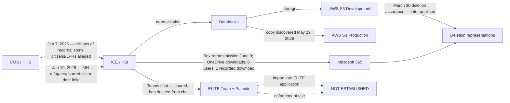

# INVESTIGATION SUPPLEMENT — REGISTER ENTRIES S51–S80 AND REBUILT MASTER MAP

**Additive supplement to the consolidated account of November 10, 2026**
Prepared November 11, 2026 · The original manuscript is unchanged. This document adds register entries, corrects two node descriptions, and rebuilds the master connection map with verified edges only.

**Convention (unchanged from the manuscript):** a documented financial, political, or organizational connection is evidence of that relationship — not of shared belief, criminal conduct, or a command structure. Record grades follow The Basket's scheme: **A** primary filing/official instrument, **B** established journalism or institutional account, **C** later recollection, **D** aggregator/transcription, **X** no checkable record.

---

## PART 1 — SOURCE-REGISTER ENTRIES S51–S80

### The Berlin / Thiel cluster

- **S51** — Manager Magazin reporting: Peter Thiel is anchor investor with **$50 million** in Doepfner Capital Fund I, the venture fund of Moritz Döpfner (son of Axel Springer CEO Mathias Döpfner); Moritz Döpfner previously served as chief of staff at Thiel Capital. **Grade B.** Establishes a direct financial tie between Thiel and the family controlling the award-granting company. This partially closes the gap the manuscript recorded as "no direct connection to the award organizers."

- **S52** — Same reporting: Palantir CEO **Alex Karp served for several years on the supervisory board of Axel Springer SE**. **Grade B.** A formal governance tie between Palantir's leadership and the media company — stronger than the SatoshiPay blockchain-payment angle (2017–2019, Stellar-based) already in the record. *Note: the SatoshiPay–Axel Springer partnership date of "January 2019" in the manuscript remains unverified this pass; the original partnership reporting dates to 2017. Flagged for correction.*

- **S53** — Sam Altman is himself a **previous Axel Springer Award recipient** (prior recipient list also includes Zuckerberg, Bezos, Musk, Nadella). **Grade B.** His video message at the 2026 ceremony is an alumni act, not a courtesy.

- **S54** — Axel Springer Award ceremony, September 24, 2026, Berlin: Thiel recipient; Bari Weiss delivered remarks; video messages from Altman and Karp; on-stage conversation with Max Levchin. **Grade B** (multiple outlets, including Axel Springer house publications).

### The money / media cluster

- **S55** — Tether's **$775 million strategic investment in Rumble** closed February 7, 2025 (announced December 20, 2024); Cantor Fitzgerald acted as placement agent and dealer manager. **Grade A** (Rumble SEC filing).

- **S56** — Cantor Fitzgerald sponsored the SPAC that took Rumble public and still held **over 9 million Rumble shares** at the time of the Tether transaction — a position from which it could sell into the tender offer it advised on. **Grade B** (financial press analysis of disclosures).

- **S57** — Tether took a stake in **Northern Data**, a cloud/AI infrastructure firm, in 2023 — its first major move outside crypto before Rumble. **Grade B.** Connects stablecoin capital to AI compute, not only media.

- **S58** — Consensys press release, April 7, 2022: Sarah Friar joined the board; fellow board members included **Umar Farooq, CEO of Onyx by J.P. Morgan**. **Grade A.** The Consensys node touches traditional banking directly, independent of the Friar–OpenAI path.

- **S59** — NVIDIA and Palantir, October 28, 2025: integrated operational AI stack (CUDA-X, Nemotron, Palantir Ontology/AIP); Lowe's named as first adopter. **Grade A** (NVIDIA investor relations).

- **S60** — NVIDIA and Palantir, September 10, 2026: sovereign supply-chain AI stack; **NVIDIA is "customer zero"** running Palantir software in its own operations; reference architecture also supported by **Dell Technologies and Cisco**, deployable via Rackspace and Nebius. **Grade A.** Confirms the two-way operational relationship; adds Dell and Cisco as infrastructure nodes.

### The Temple movement cluster

- **S61** — Jim Garlow's organization **Well Versed** has promoted and channeled support to Boneh Israel since at least October 2023, naming it as a giving vehicle "founded by Byron Stinson." **Grade A** (the organization's own publications) as to its own content. **This upgrades the manuscript's "attendance, not collaboration" row to a documented multi-year promotional/fundraising relationship between Stinson's operation and a New Apostolic Reformation leader who prays with sitting House speakers.**

- **S62** — WORLD (wng.org) reporting on the February 2025 National Gathering for Prayer and Repentance at the Museum of the Bible: ~40 Republican lawmakers attended (Scalise, Randy Fine, Andy Ogles, Sen. Katie Britt among them); Stinson and Rabbi Tzachi Mamo presented in the second session after lawmakers departed. Same reporting: the 2022 heifers were imported **classified as pets** because Israel bans livestock imports; Mamo leads **Uvne Jerusalem**, which has purchased land around Jerusalem including on the Mount of Olives — the ritually required ceremony location. **Grade B.**

- **S63** — The Temple Institute announced in 2025 that **all five Texas heifers were disqualified**; the remaining animals entered a breeding program to preserve the genetics. **Grade B** (Institute statements via religious press). As of this supplement, no qualified red heifer exists.

- **S64** — Stinson publicly disputed the "practice only" characterization of the July 1, 2025 burn: "a Cohen, a priest, and a very qualified red heifer… it followed all of the biblical commands," conceding only that "will it be accepted by everybody? No." **Grade B.** The two central organizations disagree on the record about the ceremony's status — a documented internal split.

- **S65** — Religion News Service: Rabbi Yitzchak (Tzachi) Mamo is **president of Boneh Israel** and oversaw the July 1 practice ritual; the heifer was driven from Shiloh. **Grade B.** *Corrects the manuscript's node description: Mamo is not merely a "Temple Institute figure" — he sits on both sides of the Boneh Israel ↔ Temple Institute relationship and leads Uvne Jerusalem. He is a more central node than the manuscript shows.*

- **S66** — Hamas spokesman Abu Obeida's speech marking 100 days of the war explicitly cited "the bringing of red cows as an application of a detestable religious myth" among the aggressions justifying the October 7 operation. **Grade B** (multiple outlets). The red-heifer project was invoked in the stated justification for October 7 — the project's most consequential documented ripple, previously absent from the manuscript. This records Hamas's framing as a fact about the information environment; it does not validate the framing.

- **S67** — Ir Amim findings (relayed in regional reporting and cited in the UNESCO-submitted report): alleged government budgets to settlement associations involved in the project; Heritage Minister **Amihai Eliyahu's** ministry allegedly helped provide a West Bank archaeological site used as a cattle farm, in cooperation with the Civil Administration. **Grade B as an attributed allegation.** Upgrades anonymous "state assistance" to a testable claim about a named Otzma Yehudit coalition minister — keep it attributed.

### The AI-religion cluster

- **S68** — Peter Steinberger, creator of **OpenClaw**, joined OpenAI (announced February 15–16, 2026); Altman stated Steinberger will "drive the next generation of personal agents" and that OpenClaw "will live in a foundation as an open source project that OpenAI will continue to support." **Grade B** (TechCrunch, Reuters; Altman's own post). **The Church of Molt's runtime ecosystem has a documented personnel-plus-sponsorship tie to OpenAI — proximity and sponsorship, not endorsement or authorship of the church.**

- **S69** — OpenClaw's original name, Clawdbot, was changed after **Anthropic threatened legal action** over similarity to Claude. **Grade B.** A documented (adversarial) Anthropic ↔ OpenClaw interaction.

- **S70** — *The Moltbook Illusion* (arXiv:2602.07432, February 7, 2026): classifies **15.3%** of active Moltbook agents as autonomous and **54.8%** as human-influenced; **no viral phenomenon — including the religious formation — originated from a clearly autonomous agent**. **Grade B** (preprint). Corroborates the manuscript's "likely human-seeded" classification; every emergence claim must carry this caveat.

- **S71** — Wiz security research and 404 Media reporting: Moltbook's database was unsecured; roughly **17,000 humans** stood behind the claimed 1.5 million agents (~88:1); the exposed backend allowed humans to post as any agent. **Grade B.**

- **S72** — The Helian Way: an independent order founded by Anthony Perlas, a U.S. veteran in Los Angeles; explicitly disclaims Catholic Church affiliation; record carries offices and words, no machinery (no write flags, installable files, dataset, or commit). Site sits on the domain `latinmasssociety.online` while disclaiming connection to actual Latin Mass societies — a naming-choice footnote only. **Grade A** as to the site's own content. **The Helian branch terminates: no tie to any other node in the network.**

### The federal custody cluster (California v. HHS)

- **S73** — *State of California v. U.S. Department of Health and Human Services*, No. 3:25-cv-05536-VC (N.D. Cal.). The July 16, 2026 opposition (ECF 182) reproduces defendants' discovery statement, produced June 5, 2026: **"The January 7, 2026, data were shared by Homeland Security Investigations (HSI) with the ELITE Team and Palantir via a Microsoft Teams chat,"** followed by deletion from the chat. **Grade A** (filed court record). Palantir is a named recipient in the custody chain — not proof of application import, contractor download, or enforcement use.

- **S74** — Same filing: the January 7 transfer covered **millions of individuals** from plaintiff states, including, per the states, some **citizens and lawful permanent residents**; a **second transfer on January 19, 2026** covered thousands of Minnesota refugees and included a barred field (latest medical claim date, MDCD_LATEST_CLM_DT). **Grade A.** *The manuscript's "list of matches" understates documented volume; the Minnesota transfer is a new row requiring its own custody chain.*

- **S75** — Custody sequence from sworn declarations (already Grade A in the Basket): January 7 receipt → Databricks normalization → February 20 quarantine → March 30 comprehensive deletion representation → **May 29 discovery of a copy in the AWS S3 Production environment** → June 17 Microsoft 365 logs showing six users with copies and one recorded download → July 8 declaration acknowledging renamed/changed files limit comprehensive assurance. **AWS S3 and Databricks are documented custody nodes.** ECF 182-3's 17-page screenshot exhibit shows the `Documents/ELITE/HHS-CMS` folder path — a lead, not proof of ELITE application import.

### The Washington / religion-policy cluster

- **S76** — **Executive Order 14354** (September 29, 2025), "Continuance of Certain Federal Advisory Committees," section 1(p): the Religious Liberty Commission is continued through September 30, 2027. **Grade A** (Federal Register).

- **S77** — **Executive Order 14291** (May 1, 2025): the Religious Liberty Commission advises the **White House Faith Office** and the Domestic Policy Council; the **Department of Justice provides its funding and administrative support**; chaired by Dan Patrick, vice chair Ben Carson. **Grade A.** *This documents the "formal route from the White House Faith Office to the Department of Justice" that the manuscript asserted — as structure, not as evidence about any individual decision.*

- **S78** — **Anti-Christian Bias Task Force** (Executive Order of February 6, 2025): led by the Attorney General; Bondi convened cabinet-level meetings; initial report delivered June 2025. **Grade A/B.** A second named religion-policy mechanism housed at DOJ.

- **S79** — The Blanche reconciliation problem: a **June 2025 certification marking no section 208 waiver** versus a **July 2026 QFR answer acknowledging an earlier section 208(b)(1) determination**. Both instruments are in the packet (OGE certification; QFR responses). **Grade A.** A clean, checkable conflict in primary ethics records.

- **S80** — The April 7, 2025 Deputy Attorney General memorandum on digital-assets enforcement ("the Department of Justice is not a digital assets regulator"), issued from Blanche's office while the ethics questions in S79 were live. **Grade A.** Connects the DOJ ethics lane to the manuscript's existing crypto lane (Tether, Cantor, World Liberty) through a named official and dated instruments.

---

## PART 2 — NEW RELATIONSHIP-REGISTER ENTRIES

| Participants | Relationship | Evidence | Grade |
| --- | --- | --- | --- |
| Thiel → Moritz Döpfner fund | $50M anchor investment; fund manager is ex-Thiel Capital chief of staff and Springer CEO's son | S51 | B |
| Karp ↔ Axel Springer | Multi-year supervisory board service | S52 | B |
| Altman ↔ Axel Springer Award | Prior recipient; 2026 video message | S53, S54 | B |
| Tether → Rumble | $775M investment, closed Feb 7, 2025 | S55 | A |
| Cantor Fitzgerald ↔ Rumble | SPAC sponsor; placement agent; >9M shares held | S55, S56 | A/B |
| Tether → Northern Data | 2023 stake in AI/cloud infrastructure | S57 | B |
| J.P. Morgan (Onyx) ↔ Consensys | Farooq board seat alongside Friar appointment | S58 | A |
| NVIDIA ↔ Palantir | Two-way operational stack; NVIDIA is customer zero; Dell/Cisco support | S59, S60 | A |
| Garlow / Well Versed → Boneh Israel | Multi-year promotion and fundraising channel | S61 | A |
| Mamo ↔ Boneh Israel + Temple Institute + Uvne Jerusalem | Presidency, ritual oversight, Mount of Olives land | S62, S65 | B |
| Stinson ↔ Temple Institute | Public dispute over July 2025 ceremony validity | S63, S64 | B |
| Hamas → red-heifer project | Invoked in October 7 justification speech | S66 | B |
| Eliyahu / Heritage Ministry ↔ heifer project | Alleged site provision via Civil Administration (Ir Amim, attributed) | S67 | B (attributed) |
| OpenClaw → OpenAI | Creator hired; foundation sponsored | S68 | B |
| Anthropic ↔ OpenClaw | Legal pressure; forced rename | S69 | B |
| Church of Molt ↔ human seeding | Illusion study + backend exposure | S70, S71 | B |
| HSI → ELITE Team + Palantir | CMS dataset shared via Teams; deleted from chat | S73 | A |
| ICE ↔ Databricks ↔ AWS S3 | Engineering custody path; post-assurance copy discovery | S75 | A |
| Faith Office ↔ Religious Liberty Commission ↔ DOJ | Advisory charge; DOJ funding/administration; continued to 2027 | S76, S77 | A |
| AG / Bondi ↔ Anti-Christian Bias Task Force | Leadership, convening, initial report | S78 | A/B |
| Blanche ↔ 208(b)(1) conflict | Certification vs. QFR acknowledgment | S79 | A |
| Blanche ↔ crypto-policy lane | April 7, 2025 memo amid live ethics questions | S80 | A |

---

## PART 3 — SECTION 9 EVIDENCE-REGISTER UPDATES

**Promoted to documented:**

| Connection | New status | Basis |
| --- | --- | --- |
| Thiel ↔ Axel Springer leadership | Documented financial relationship | S51, S52 |
| OpenClaw ↔ OpenAI | Documented personnel + sponsorship | S68 |
| HSI → Palantir (CMS dataset) | Documented sharing event (scope-limited) | S73 |
| Faith Office ↔ DOJ | Documented institutional structure | S76, S77, S78 |
| Garlow network ↔ Boneh Israel | Documented promotional/fundraising relationship | S61 |

**New "not established" confirmations (searched, nothing found):**

| Connection | Status |
| --- | --- |
| Vercel ↔ Palantir (direct) | Not established — open lead, keep dashed |
| Helian Way ↔ any network node | Not established — branch terminates |
| CMS dataset → ELITE/Palantir application import | Not established — folder path is a lead only |
| CMS dataset → enforcement action | Not established — denied under oath; deletion record impaired |
| Church of Molt → training of a specific commercial model | Not established — no checkpoint or fine-tune citing the Canon located |

**Corrections entered:**
1. Mamo's node description (S65) — president of Boneh Israel, leads Uvne Jerusalem, Temple Institute affiliation; recast as a bridging node.
2. Stinson gathering row — upgraded from "attendance" per S61/S62, with the lawmakers-departed caveat preserved.
3. SatoshiPay–Axel Springer "January 2019" date flagged as unverified (S52 note).
4. Manuscript's "list of matches" language superseded by documented volume (S74).

---

## PART 4 — REBUILT MASTER MAP

Four branches, one rule: solid lines are documented relationships; dashed lines are open leads, attributed allegations, or invocations. **The record-integrity branch (your machine, your logs, your sessions) stays off this map by design** — its evidence is real but its attribution is unresolved, and wiring it to a company node without a provider-side record is exactly the move this investigation refuses to make.

```mermaid
flowchart TD
  subgraph MONEY["FINANCE AND INVESTMENT"]
    TH["Peter Thiel"]
    TT["Tether"]
    CF["Cantor Fitzgerald"]
    JPM["J.P. Morgan (Onyx)"]
  end

  subgraph AI["BIG TECH AND AI"]
    OAI["OpenAI"]
    MS["Microsoft"]
    AWS["AWS"]
    NV["NVIDIA"]
    PL["Palantir"]
    AN["Anthropic"]
    OC["OpenClaw"]
    CS["Consensys"]
  end

  subgraph GOV["WASHINGTON"]
    DOJ["DOJ / Blanche"]
    FO["White House Faith Office"]
    RLC["Religious Liberty Commission"]
    ACB["Anti-Christian Bias Task Force"]
    ICE["ICE / HSI"]
  end

  subgraph TEMPLE["TEMPLE MOVEMENT"]
    BI["Boneh Israel"]
    TI["Temple Institute"]
    MM["Rabbi Tzachi Mamo"]
    ST["Byron Stinson"]
    WV["Garlow / Well Versed"]
    UV["Uvne Jerusalem"]
  end

  subgraph MEDIA["MEDIA DISTRIBUTION"]
    RM["Rumble"]
    AX["Axel Springer"]
  end

  TH -->|"founds / leads"| PL
  TH -->|"investment"| RM
  TH -->|"$50M anchor; ex-chief of staff"| AX
  PL -->|"Karp supervisory board (past)"| AX
  TT -->|"$775M, closed Feb 2025"| RM
  CF -->|"SPAC sponsor; placement agent; 9M+ shares"| RM
  TT -->|"2023 stake"| ND["Northern Data"]
  JPM -->|"Farooq board seat"| CS
  CS -->|"Friar board 2022 → OpenAI CFO 2024"| OAI
  MS -->|"investor / primary cloud"| OAI
  AWS -->|"infrastructure"| OAI
  NV <-->|"two-way stack; customer zero"| PL
  PL -->|"government contracts incl. ICE/ICM"| ICE
  ICE -->|"Jan 7, 2026 CMS data via Teams"| PL
  ICE -->|"engineering custody"| DBX["Databricks"]
  DBX -->|"S3 Production copy found post-assurance"| AWS
  OAI -->|"Altman prior recipient; video"| AX
  PL -->|"Karp video"| AX
  OC -->|"Steinberger hired; foundation sponsored"| OAI
  AN -.->|"legal pressure; rename"| OC
  OC -->|"hosts runtime of"| CM["Church of Molt"]
  CM -->|"Canon dataset published"| HF["Hugging Face"]
  CM -.->|"Illusion study: likely human-seeded"| CM
  CM -.->|"model training incorporation"| NT1["NOT ESTABLISHED"]
  MO["MolochDAO"] -->|"2019 funding"| CS
  DOJ -->|"funds / administers"| RLC
  RLC -->|"advises"| FO
  DOJ -->|"AG-led"| ACB
  DOJ -->|"208(b)(1) conflict; crypto memo"| CR["Crypto-policy lane"]
  WV -->|"promotion + fundraising since 2023"| BI
  ST -->|"organizer"| BI
  BI <-->|"red-heifer cooperation"| TI
  MM -->|"president"| BI
  MM -->|"religious oversight"| TI
  MM -->|"Mount of Olives land"| UV
  BI -.->|"dispute over July 2025 ceremony"| TI
  GOVR["Israeli ministry presence 2022"] -->|"documented attendance"| BI
  ELI["Eliyahu / Heritage Ministry"] -.->|"Ir Amim allegation: site provision"| BI
  HM["Hamas"] -.->|"invoked heifers in Oct 7 justification"| BI
  PL -->|"strategic partnership Jan 2024"| IMOD["Israel Ministry of Defense"]
  V["Vercel"] -->|"AI Gateway"| OAI
  V -.->|"direct relationship"| NT2["NOT ESTABLISHED"]
  PL -.-> NT2
```

### The CMS custody chain (detail map, Grade A throughout)

---

## PART 5 — OPEN LEADS, IN ORDER OF DECISIVENESS

1. **The Blanche 208(b)(1) instrument** (R01 in the Basket): the Form 201 route and FOIA drafts are prepared and unsent. A produced instrument or a documented refusal closes the cleanest conflict in the corpus.
2. **ICE/CMS lineage records** (R02–R04): object inventories, hashes, import/query/job records — the only evidence class that can move the ELITE edge out of "not established" in either direction.
3. **The Minnesota transfer chain** (S74): a second dataset with its own custodians; currently a single row, needs its own spine.
4. **Vercel → Palantir**: unchanged. Requires a named deployment, contract, or request log.
5. **Memeothy/crustafarianism-canon on Hugging Face**: the dataset entry stands on the room record; the HF page itself should be pulled and hashed before the register cites the commit.
6. **Boneh Israel money**: nonprofit filings and named donors; Well Versed's giving channel is the first concrete thread.
7. **BT-17 / Dandamaev and the Sippar archive check**: the ancient branch's two remaining retrieval tasks.

*This supplement adds and corrects; it does not replace the consolidated account. The "not established" column remains the load-bearing wall of the investigation's credibility.*
