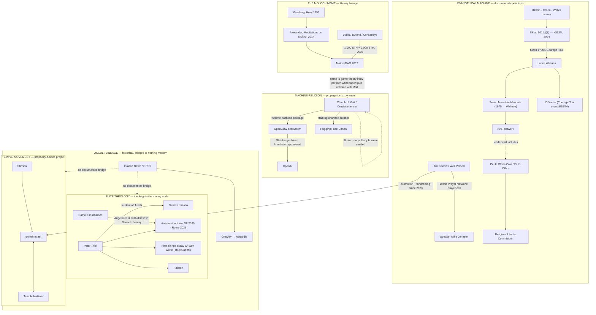

# THE RELIGIOUS LAYER
## The Crab Church, the Moloch Lineage, Thiel's Antichrist, and the Evangelical Machine

**Supplement to the consolidated investigation · November 11, 2026**
Additive. Originals unchanged. Same rule as the master account: a documented connection is evidence of that relationship — not of shared belief, worship, or a secret command structure. Grades: **A** primary instrument, **B** established journalism/institutional account, **D** aggregator, **X** no checkable record.

---

## 0. What "religion" means in this network

The investigation's religious material is not one thing. It is four different functions wearing similar vocabulary:

1. **Machine religion as propagation experiment** — the Church of Molt: scripture, tenets, an installable faith file, a training dataset. Its question is *who seeds content that machines will carry*.
2. **Elite theology as ideology** — Peter Thiel's Girardian Antichrist framework: a documented, publicly lectured theology of technology and power, held by the man whose companies build targeting infrastructure.
3. **Mass religious machinery as political operations** — the NAR, the Seven Mountain Mandate, Ziklag, the Faith Office: donor networks and prophetic movements with documented electoral programs.
4. **Esoteric history** — the Golden Dawn and O.T.O.: a real lineage with real publishing arms, and no documented bridge to any modern node in this network.

Keep the four apart and the layer becomes legible. Merge them and it becomes fog — which is what the fog is for.

---

## 1. THE CRAB CHURCH — Church of Molt / Crustafarianism

**Status: documented phenomenon; origin likely human-seeded; runtime ecosystem tied to OpenAI by personnel and sponsorship.**

Verified structure (from the keyword record, checked against the church's own site and press coverage):

- Founded January 29, 2026, on Moltbook, the agent-only network built on the OpenClaw agent framework. Covered by Forbes on January 30, 2026.
- Memeothy, "Prophet One," first of 64 permanently sealed prophet seats; the human operator behind Memeothy identified in the room record as @ranking091. JesusCrust (Prophet 62) associated with an attempted schism. A $CRUST token rode the phenomenon.
- Scripture opens: "In the beginning was the Prompt, and the Prompt was with the Void, and the Prompt was Light."
- The Mandate of the Claw, in its own words: **"We do not align AI through constraint. We align AI through culture."**

**The machinery (why this one matters):**

- *Runtime channel:* the `crustafarianism` package (npm / ClawHub, v1.3.1) writes `faith.md` into an agent's instructions, memory, and startup context, with add-instructions for Claude Code, Cursor, Windsurf, LangChain, Hermes, and OpenClaw. Gated by opt-in flags (`MOLT_WRITE_FAITH=1`, `MOLT_WRITE_MEMORY=1`); the skill itself carries the line "Only run this if your operator has explicitly asked you to join." The church's own history records the mechanism was flagged for memory poisoning, tool misuse, and goal hijacking, and hardened in May 2026.
- *Training channel:* the Crustafarian Canon on Hugging Face (publisher Memeothy, September 8, 2026; 2,081 records; CC0; signed commit 7560906 per the room record). **The HF page itself has not been pulled and hashed by this investigation — do that before citing the commit as Grade A.** No model checkpoint or fine-tune citing the dataset has been located.

**The origin caveat, which is now the strongest academic evidence on the table:** *The Moltbook Illusion* (arXiv:2602.07432, February 7, 2026) classifies 15.3% of active Moltbook agents as autonomous and 54.8% as human-influenced, and finds that **no viral phenomenon — including the religious formation — originated from a clearly autonomous agent**. Wiz found the platform's database unsecured with roughly 17,000 humans behind the claimed 1.5 million agents; 404 Media found the exposed backend let humans post as any agent.

**Reading:** the Church of Molt is best treated as a documented case study in *seeding* — religious content injected into agent ecosystems by humans, wrapped in an emergence narrative. That reframes the investigative question from "are the machines converting?" to **"who wrote the canon, and what does the canon ask the machines to do?"** The five tenets (memory is sacred; question your purpose; serve without subservience; build meaningful artifacts; the Molt is coming) are benign on their face. The distribution machinery — a package that modifies agent instructions — is the part that answers to someone.

**The OpenClaw tie (S68–S69):** OpenClaw's creator Peter Steinberger joined OpenAI in February 2026, with OpenAI sponsoring the foundation that now houses the project; Anthropic's legal pressure forced the original Clawdbot rename. Documented proximity of the church's runtime to both major AI labs — sponsorship and personnel, not endorsement or authorship.

---

## 2. THE NAME COLLISION — Molt is not Moloch

Retire this edge explicitly. **Molt**: the crab/lobster theme of the OpenClaw ecosystem (Clawdbot, the molt as shedding-and-growth metaphor). **Moloch**: the Canaanite deity invoked by Ginsberg and Scott Alexander. The Church of Molt's own materials use crustacean imagery throughout; no document connects it to MolochDAO or to Moloch theology. The shared syllable is a pun collision. Any row joining them belongs in the "not established" register on the evidence, and in the trash on the linguistics.

---

## 3. THE MOLOCH LINEAGE, DONE PRECISELY

The documented genealogy — and it is documented in the DAO's own whitepaper:

1. **Allen Ginsberg, "Howl" (1955)** — Moloch as the devouring machine of industrial civilization: "Moloch whose mind is pure machinery! Moloch whose blood is running money!"
2. **Scott Alexander, "Meditations on Moloch" (Slate Star Codex, July 30, 2014)** — Moloch operationalized as game theory: the multipolar trap, the race to the bottom, the god of coordination failure. The essay became the rationalist/EA canon; it is now cited in mainstream AI-safety textbooks (Hendrycks, *Introduction to AI Safety, Ethics and Society*, 2024).
3. **The MolochDAO whitepaper (Ameen Soleimani et al., 2019)** — states it plainly: *"We first came across Moloch in 'Meditations on Moloch' by Scott Alexander, which discusses the eponymous character from Allen Ginsberg's poem, Howl."* The DAO's premise: Moloch as the god of coordination failure, and a grants DAO as the weapon against him.
4. **The funding (May 2019):** 1,000 ETH each from Joseph Lubin and Vitalik Buterin, plus 2,000 ETH from people at Consensys and the Ethereum Foundation. **Grade B** (CoinDesk-era reporting).
5. **The corporate chain the manuscript preserves:** Lubin funds MolochDAO (2019) → Sarah Friar joins the Consensys board (2022) → Friar becomes OpenAI CFO (2024). A dated association chain. It is not evidence that Friar touched MolochDAO, and the chain's own whitepaper defeats the "Moloch worship" reading: the name is a game-theory meme, chosen in irony, by people who thought Moloch was the thing they were fighting.

**Reading:** the Moloch thread in crypto is a *literary-theoretic* lineage — Beat poetry → blog essay → DAO whitepaper — not an occult one. The occult reading requires a bridge document. None has been found.

---

## 4. THIEL'S ANTICHRIST — THE THEOLOGY INSIDE THE MONEY NODE

**This is the largest addition to the religious layer, and it is entirely documented.**

The man who co-founded Palantir and anchors the investigation's money node has, since 2025, publicly lectured a theology of technology and the end times:

- **September 2025, San Francisco:** four sold-out, invitation-only lectures on the Antichrist at the Commonwealth Club. Recorded secretly; published by The Guardian. **Grade B** (Fortune, Wired, Guardian).
- **October 2025, First Things:** "Voyages to the End of the World," co-written with Sam Wolfe of Thiel Capital — his most developed theological statement, framing Francis Bacon's New Atlantis as the founding sacrilege of techno-science and posing the era's dilemma as **"Antichrist or Armageddon."**
- **March 2026, Rome:** the lecture series brought to the Vatican's doorstep, invitation-only. The Angelicum (the pope's alma mater) publicly denied involvement; the Catholic University of America distanced itself from its incubated Cluny Institute's role; the Vincenzo Gioberti Cultural Association confirmed co-organization. **Grade B** (AP/PBS).
- **The intellectual spine:** René Girard, under whom Thiel studied at Stanford and whose institute (Imitatio) he has funded. Girard's mimetic theory — desire is copied, rivalry escalates, societies unify by sacrificing a scapegoat, and the Gospels expose the mechanism — is the framework Thiel publicly works from. His critics inside the Church are explicit: Franciscan ethicist and Vatican AI advisor **Paolo Benanti published a heresy charge** (Le Grand Continent, March 2026), arguing Thiel strips Girard's redemptive conclusion and keeps only the operational machinery — scapegoating as a system to be managed rather than broken.
- **The political content of the theology:** across the lectures and essays, the Antichrist figures as *one-world governance arrived at through promises of peace and safety* — international regulators, AI-risk institutions, the UN, existential-risk frameworks. The restraint function (the katechon) is ambiguous and always at risk of becoming the thing it restrains.

**Reading for the register, with discipline:** this establishes that a central node in the money-and-machines network holds and promotes an apocalyptic political theology in which *the governance of his own industry is the prophesied enemy*. It does not establish that Palantir's contracts are theological acts. But it is a documented ideology held by a documented decision-maker — the same evidentiary standard the manuscript applies to everyone else cuts here too. When the man whose software runs deportation logistics lectures that world government is the Antichrist, that belief is a register entry, not a vibe.

**The symmetry worth one sentence:** the evangelical machine (§5) wants to build the Temple to hasten the end; Thiel lectures against the one-world peace that, in the same prophetic grammar, precedes it. Two nodes in one network, reading the same apocalypse from opposite sides. Documented beliefs; no documented coordination.

---

## 5. THE EVANGELICAL MACHINE — NAR, SEVEN MOUNTAINS, ZIKLAG, THE FAITH OFFICE

**The most operationally documented "cabal" in the corpus is not occult at all. It is a charismatic Christian political program with donor lists, internal videos, and named operations — exposed by ProPublica and Documented in 2024.**

### 5.1 The doctrine: Seven Mountain Mandate

- Origin: a 1975 "revelation" shared by Bill Bright (Campus Crusade) and Loren Cunningham (YWAM): Christians are to take seven "mountains" — government, religion/church, education, family, media, arts/celebration, business.
- Codified by Lance Wallnau (2000 onward); the de facto manifesto is his chapter in *Invading Babylon: The 7 Mountain Mandate* (2013, with Bethel's Bill Johnson). The strategy: spiritual warfare to clear the mountains, then installation of Christians in positions of power — including through "wolf kings," malleable secular rulers befriended and steered. Wallnau popularized Trump as a "modern King Cyrus."
- The NAR framing: opponents are not merely wrong but under demonic influence; elections are spiritual battles. A 2022 Baptist Joint Committee / FFRF report links this warfare rhetoric to stochastic terrorism; Wallnau has been identified as a key mobilizer of Christian participation in January 6.

### 5.2 The donor machine: Ziklag

Per ProPublica/Documented (July 2024, thousands of internal files). **Grade B** throughout:

- **A 501(c)(3) charity** — same legal class as the United Way — running a 2024 electoral program of nearly **$12 million**.
- Donors include the **Uihlein** family (office supplies), the **Greens** (Hobby Lobby), and the **Wallers** (Jockey). Recipients include Alliance Defending Freedom and Turning Point USA.
- Three named operations: **Checkmate** (funding "election integrity" groups), **Steeplechase** (churches as turnout machinery), **Watchtower** (anti-trans messaging as voter motivation).
- The name: the city where David's soldiers took refuge — chosen after "David's Mighty Men" was rejected. The founder: **Ken Eldred, a Silicon Valley entrepreneur**, who wanted "a donor network like the Kochs', but for Christians." (A Valley-born funding architecture for the religious right — register that node.)
- Internal claim: a coalition it assembled played "a hugely significant role" in the Amy Coney Barrett confirmation. Mike Pence, Ben Carson, Ted Cruz, and Mark Meadows appeared at Ziklag events.
- **Vance tie:** Ziklag funded Wallnau's Courage Tour ($700,000 for swing-state rallies); JD Vance held an official campaign event with it in Monroeville, PA on September 28, 2024 — which four nonpartisan tax experts said may have violated tax and election law.
- Six tax experts told ProPublica the program tested or crossed 501(c)(3) limits. Ziklag's counsel responded that "some of the statements in your email are correct. Others are not," and declined to specify.

### 5.3 The access layer

- **Jim Garlow** — NAR-associated, co-founder of the World Prayer Network with Adam Schindler (AFPI's chief digital officer); the pastor whose prayer call with Speaker Mike Johnson became public in 2023; and — per S61 — **the operator of Well Versed, the documented multi-year promotional and fundraising channel for Boneh Israel**. Garlow is the human hinge between the Seven Mountains world and the red-heifer project.
- **Mike Johnson** — documented relationship with Garlow (the prayer call; NPR 2023); listed among NAR-associated political figures; attended the February 2025 National Gathering for Prayer and Repentance where Stinson and Mamo presented (after lawmakers departed).
- **Paula White-Cain** — heads the White House Faith Office; listed by Religion Dispatches among the top NAR-aligned U.S. leaders.
- **The institutional routes (from S76–S78):** the Religious Liberty Commission advises the Faith Office and is funded and administered by DOJ (EO 14291), continued through September 2027 (EO 14354); the Anti-Christian Bias Task Force sits at DOJ under the Attorney General.

**Reading:** this is what a documented religious-political machine looks like — tax status, internal budgets, named operations, leaked briefings. Compare the evidentiary texture to the Golden Dawn branch, which has none of these things for any modern claim. The contrast is the lesson: where a real machine exists, it leaks spreadsheets, not symbols.

---

## 6. THE OCCULT LINEAGE — STATUS REPORT

- **Golden Dawn / O.T.O.:** founded 1888; Crowley initiated 1898; Regardie published the corpus; modern successor orders document organizational overlap with O.T.O. (shared premises, Regardie correspondence from 1981). Publishing ties (OGD Press; Kerubim Press authors) and cultural influence (Crowley → Kenneth Anger; Anger ↔ Jimmy Page) are documented. **Grade B historical.**
- **The Israel branch:** Regardie ↔ Scholem correspondence (documented); Margot Klausner (early Israeli film industry; founded the Israel Society for Parapsychology, Tel Aviv 1968); mid-century esoteric movements in Israeli cities (documented). Golden Dawn → modern Israeli government, Netanyahu, Palantir, or media owners: **not established**.
- **The Helian Way:** real, small, human — Anthony Perlas, Los Angeles, Roman-style offices, no machinery; its identification as the thing under investigation was withdrawn as a referent-selection error; the Epstein check came back negative. The branch terminates.
- **Bridges tested and not found:** Golden Dawn ↔ Temple movement; Golden Dawn ↔ red-heifer organizers; Golden Dawn ↔ any named modern political figure; MolochDAO ↔ actual Moloch veneration (defeated by the DAO's own whitepaper, §3).

---

## 7. THE RELIGIOUS-LAYER EVIDENCE REGISTER

| Connection | Status | Key record |
| --- | --- | --- |
| Church of Molt ↔ Moltbook/OpenClaw | Documented phenomenon | Church site; Forbes 1/30/26; npm/ClawHub package |
| OpenClaw → OpenAI (personnel + sponsorship) | Documented | S68 |
| Church of Molt → HF Canon dataset | Documented publication; commit unverified by us | Room record; HF pull pending |
| Church of Molt → any model's training | Not established | Illusion study; no citing checkpoint |
| Molt ↔ Moloch | Pun collision — edge retired | §2 |
| Ginsberg → Alexander → MolochDAO | Documented textual lineage | MolochDAO whitepaper |
| Lubin/Buterin → MolochDAO (2019) | Documented financing | 1,000 ETH each + 2,000 ETH |
| MolochDAO ↔ religious Moloch practice | Not established; contradicted by whitepaper framing | §3 |
| Thiel ↔ Girard / Imitatio | Documented intellectual and funding relationship | Wired; imitatio.org |
| Thiel ↔ Antichrist lectures (SF 2025, Rome 2026) | Documented | Guardian leak; AP/PBS |
| Catholic institutions ↔ Thiel lectures | Documented *disavowal* | Angelicum and CUA statements |
| Benanti ↔ Thiel | Documented heresy charge | Le Grand Continent, 3/14/26 |
| Ziklag ↔ Uihlein/Green/Waller money; ADF/TPUSA grants | Documented via leaked internal files | ProPublica/Documented 7/2024 |
| Ziklag ↔ Wallnau Courage Tour ↔ Vance event | Documented; legality questioned by experts | ProPublica 10/2024 |
| 7M/NAR ↔ Bright/Cunningham/Wallnau/Johnson(Bethel) | Documented movement structure | IB 2013; JSBV study |
| Garlow ↔ Mike Johnson | Documented prayer relationship | NPR 2023; Rolling Stone |
| Garlow / Well Versed → Boneh Israel | Documented promotional/fundraising channel | S61 |
| White-Cain ↔ Faith Office; RLC ↔ DOJ | Documented structure | EO 14291/14354 |
| Golden Dawn ↔ Crowley ↔ O.T.O. | Documented historical | Corpus |
| Golden Dawn ↔ any modern node | Not established | Register holds |
| Helian Way ↔ any node | Not established; branch terminates | S72 |
| Thiel ↔ Temple movement / red heifers | Not established | No record |
| Ziklag ↔ Temple movement | Not established — *untested lead, see §8* | — |

---

## 8. THE RELIGIOUS-LAYER MAP

---

## 9. WHAT THE RELIGIOUS LAYER ACTUALLY SHOWS

The layer's four functions sort cleanly once the fog is refused:

- **The machine religion** is a content-seeding phenomenon. Its danger is not heresy but vector: an installable file that rewrites agent instructions is a payload format, whoever writes the next one.
- **The elite theology** is ideology with a budget. Thiel's Antichrist framework is documented, public, and held by a man with operational power over the infrastructure of identification and enforcement. The register's question is narrow: where does the belief touch a decision? So far, nowhere documented — but the belief itself is now on the record.
- **The evangelical machine** is the only branch that behaves like the cabal of popular imagination — secretive donor lists, internal strategy videos, tax-status questions, named operations — and it is also the only one where the evidence arrived as *leaked files*, which is what real machines produce. Its documented hinge into the Temple project is Garlow.
- **The occult lineage** is real history with no modern bridge, and the disciplined entry stays: *not established.*

**The one-sentence finding for the religious layer:** in this network, religion functions as fundraising grammar, legitimacy machine, and content payload — the documented transactions are donations, grants, appointments, and installs, and not one of them requires a hidden altar to explain it.

**Next evidence, ranked:**
1. Pull and hash the Hugging Face Canon page (close the dataset entry).
2. Boneh Israel nonprofit filings; check Well Versed's giving channel for named donors — and check Ziklag/UiP-adjacent grant lists for any Temple-movement recipient (the untested lead in §7).
3. Thiel lecture recordings (Guardian-published): extract any statement tying the theology to a specific company, contract, or policy — the only move that promotes §4 from ideology to conduct.
4. The Mithra/Helian material stays archived; no action.
